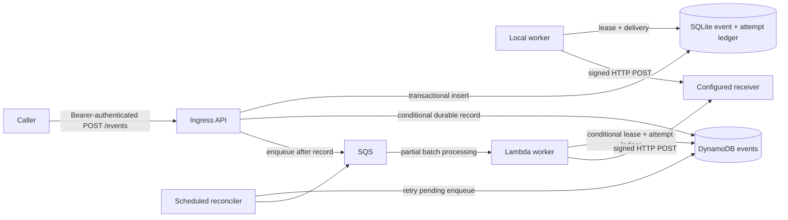

# Relay Service

Relay Service accepts authenticated webhook events, stores them durably, and delivers them to operator-configured destinations. It has a local Python/SQLite mode and an AWS Lambda, API Gateway, SQS, and DynamoDB configuration.

## Run the local demo

The demo starts a real local HTTP receiver and API, writes to a temporary SQLite database, signs a delivery, exercises a receiver failure, retries, and verifies the signature. It does not use AWS.

Windows PowerShell:

```powershell
py -3.12 -m venv .venv
.\.venv\Scripts\Activate.ps1
python -m pip install -e ".[dev]"
relay-service demo
```

Linux or macOS:

```sh
python3.12 -m venv .venv
. .venv/bin/activate
python -m pip install -e '.[dev]'
relay-service demo
```

The runtime supports Python 3.12 only. The demo uses temporary files and ports and removes them when it exits.

Run the local SQLite and HTTP behavior check with `python -m pytest -q tests/test_local_http.py`. The integration checks use [Floci](https://github.com/floci-io/floci) for DynamoDB, SQS, and Secrets Manager. They invoke the Python Lambda handlers directly; Floci does not run the Lambda runtime in this test path. The outbound receiver is held at the HTTP boundary so the checks never contact a public endpoint.

To run the Floci integration checks, start the version and digest pinned emulator in `compose.floci.yaml` and set the local endpoint. The fixture rejects non-loopback endpoints, supplies fake AWS credentials, and sets `AWS_ENDPOINT_URL`, so these checks cannot fall through to AWS.

Windows PowerShell:

```powershell
try {
  docker compose -f compose.floci.yaml up -d
  $env:RELAY_FLOCI_ENDPOINT_URL = 'http://127.0.0.1:4566'
  $env:RELAY_FLOCI_REQUIRED = 'true'
  python -m pytest -q tests/test_floci_integration.py
} finally {
  docker compose -f compose.floci.yaml down
  Remove-Item Env:RELAY_FLOCI_ENDPOINT_URL, Env:RELAY_FLOCI_REQUIRED -ErrorAction SilentlyContinue
}
```

Linux or macOS:

```sh
docker compose -f compose.floci.yaml up -d
trap 'docker compose -f compose.floci.yaml down' EXIT
RELAY_FLOCI_ENDPOINT_URL=http://127.0.0.1:4566 \
RELAY_FLOCI_REQUIRED=true \
  python -m pytest -q tests/test_floci_integration.py
```

The Floci checks cover authenticated idempotent ingress and conflicting-key rejection, recovery of a durable event after an SQS enqueue failure, signed queue delivery and attempt records, dead-event replay audit, and malformed-message partial failure into the SQS dead-letter queue. They exercise real emulator services and do not validate AWS service behavior or Lambda execution. When `RELAY_FLOCI_ENDPOINT_URL` is not set, pytest skips these integration checks; CI sets `RELAY_FLOCI_REQUIRED=true`, so a missing or unhealthy emulator fails the job.

To run the API and worker in containers, configure the destination URL in `.env` to an address reachable from both containers (for a host receiver in Docker Desktop, use `host.docker.internal`), then run `docker compose up --build`. The example `127.0.0.1` destination is intended for native local processes; inside a container, it points back to that container.

## Run the local service

Copy `.env.example` to `.env`, replace both placeholder secrets with independent random values, then load the variables into the shell where the API and worker will run. For example, in Bash:

```sh
set -a
. ./.env
set +a
```

In PowerShell, load the simple `KEY=value` lines from `.env` into the current process:

```powershell
Get-Content .env | ForEach-Object {
  if ($_ -match '^\s*([^#][^=]*)=(.*)$') {
    $value = $matches[2].Trim()
    if ($value.Length -ge 2 -and $value[0] -eq "'" -and $value[-1] -eq "'") {
      $value = $value.Substring(1, $value.Length - 2)
    }
    [Environment]::SetEnvironmentVariable($matches[1].Trim(), $value, 'Process')
  }
}
```

Run the API and worker in separate shells with the same environment:

```sh
relay-service serve --host 127.0.0.1 --port 8000
relay-service worker
```

`relay-service worker --once` claims at most one ready event. `relay-service inspect` lists the latest 100 event summaries; `relay-service inspect --event-id <id>` returns one event. `relay-service replay <id> --reason "operator explanation"` requeues a dead event as a new generation and records the current OS username and reason in the audit log.

For a local caller, send `POST /events` with a JSON body such as `{"destination":"demo","payload":{"order_id":"123"}}` and headers `Authorization: Bearer <RELAY_INGRESS_SECRET>`, `X-Caller-ID`, and `Idempotency-Key`. Use a unique idempotency key per event. The service responds with `202` and an `event_id` after the event is committed to SQLite.

Local routes are `GET /health`, `POST /events`, and authenticated `GET /events/{event_id}`. The development server uses plain HTTP and is intended for local use. Its `--host` option defaults to `127.0.0.1`.

## Event and delivery contract

- Request bodies contain exactly `destination` and `payload`; `payload` must be a JSON object. Destinations are names from server configuration. Callers cannot supply a URL.
- The idempotency scope is `(X-Caller-ID, Idempotency-Key)`. The request hash covers canonical JSON for the destination and payload. Reusing a key for the same request returns the original event; reusing it for a different request returns `409`.
- The bearer token is shared by this single-tenant service. `X-Caller-ID` is a caller-provided idempotency namespace; it is not authenticated caller identity or tenant isolation.
- Cloud replay uses `POST /events/{event_id}/replay` with `{"reason":"operator explanation"}` and a separate operator bearer token. In AWS, ingress and replay read different Secrets Manager secrets; the replay audit actor is set by the server after operator authentication and does not come from `X-Caller-ID`.
- Delivery is **at least once**. A receiver should verify the signature and timestamp and deduplicate by `(X-Relay-Event-ID, X-Relay-Generation)`. Retries within one generation keep the same pair; an operator replay increments the generation.
- The signature is `sha256=` followed by lowercase hex HMAC-SHA256 over the ASCII timestamp, a period, and the exact raw request body. Receivers should use constant-time comparison and reject timestamps more than five minutes from their clock.
- Network errors, HTTP `408`, `429`, and `5xx` responses retry with capped exponential backoff. Redirects and other `4xx` responses are terminal. Events become `dead` after a terminal response or the configured maximum attempts.

The relay does not provide exactly-once delivery. Receivers must retain deduplication keys long enough to cover retries and any operator replay policy.

## Configuration

`RELAY_DESTINATIONS_JSON` is a JSON object keyed by destination name. Each entry must contain `url` and `secret_ref` only. In local mode, `secret_ref` uses `env:VARIABLE_NAME`; in AWS mode it is a Secrets Manager secret ARN. Keep destination URLs fixed in server configuration.

| Variable | Default | Meaning |
| --- | --- | --- |
| `RELAY_MODE` | `local` | Local CLI selects SQLite; AWS handlers select AWS mode internally. |
| `RELAY_DATABASE` | `relay.sqlite3` | SQLite file path in local mode. |
| `RELAY_INGRESS_SECRET` | none | Required local bearer token. |
| `RELAY_INGRESS_SECRET_ARN` | none | AWS API Lambda secret ARN for `POST /events`. |
| `RELAY_OPERATOR_SECRET_ARN` | none | AWS API Lambda secret ARN for replay; it must differ from the ingress secret ARN. |
| `RELAY_DESTINATIONS_JSON` | `{}` | Required named destination map. |
| `RELAY_MAX_ATTEMPTS` | `5` | Maximum delivery attempts in one generation. |
| `RELAY_RETRY_BASE_SECONDS` | `1` | Exponential backoff base. |
| `RELAY_RETRY_MAX_SECONDS` | `300` | Backoff cap. |
| `RELAY_REQUEST_TIMEOUT_SECONDS` | `10` | Per-delivery HTTP timeout. |

Requests are limited to 262,144 bytes. AWS destinations must use HTTPS and cannot use obvious local hostnames or literal non-public IP addresses. The destination operator remains part of the security boundary: hostname resolution is not pinned to a checked IP, so DNS rebinding and later DNS changes are not prevented by application validation. Use operator-controlled endpoints and enforce egress restrictions in the network when stronger destination isolation is required. Redirects are never followed.

## Architecture



The local worker claims events under a SQLite write transaction and records each attempt. When the final attempt's lease expires before completion, both stores abandon that attempt and mark the event dead before another delivery can start. In AWS, the worker acknowledges that SQS message after the durable dead-state transition, and the reconciler only considers pending events. The AWS ingress writes the event before SQS enqueue; the scheduled reconciler recovers records whose enqueue was not accepted. Both modes can deliver more than once when a receiver accepts a request but the acknowledgement is lost.

## AWS configuration and validation

AWS resources are defined in [`infra/terraform`](infra/terraform). The configuration creates API Gateway HTTP API routes, Lambda functions, a DynamoDB table with point-in-time recovery and indexes, encrypted SQS queues with a dead-letter queue, least-privilege IAM policies, log retention, and CloudWatch alarms. It requires distinct `ingress_secret_arn` and `operator_secret_arn` values plus destination secret ARNs; it references Secrets Manager ARNs and does not put secret values in Terraform variables or state.

No live AWS environment has been deployed or validated here. Terraform validation and an offline plan do not confirm AWS credentials, permissions, service quotas, networking, or runtime behavior.

To create the Lambda package and validate the configuration locally:

```sh
python scripts/package_lambda.py
cd infra/terraform
terraform init
terraform fmt -check -recursive
terraform validate
terraform plan -var-file=terraform.tfvars
```

For a plan that does not contact AWS, copy `terraform.tfvars.example` to `terraform.tfvars` and keep `offline_plan = true`. It uses placeholder account and secret ARNs and is only a configuration check. A real plan requires a valid account ID, distinct ingress and operator Secrets Manager ARNs, destination secret ARNs, AWS credentials, and `offline_plan = false`. `terraform apply` creates paid resources and is not included in these steps.

The SQS visibility timeout defaults to 210 seconds for a 30-second worker Lambda with no batching window. If the worker timeout or batching window changes, update `queue_visibility_seconds` to at least six times the Lambda timeout plus the batching window.

## CI and local checks

The GitHub Actions workflow runs Ruff, the local behavior test, and the AWS-handler integration checks against the pinned Floci container, plus dependency auditing, secret scanning, and Lambda packaging. The emulator check calls Lambda handlers directly and is not a Lambda runtime or AWS deployment check. Terraform checks require the Terraform CLI and a built Lambda ZIP; an offline plan uses no AWS account. No AWS deployment or live AWS validation is claimed.

## Operations

See [`docs/operations.md`](docs/operations.md) for retry, replay, secret rotation, and failure-recovery guidance.
